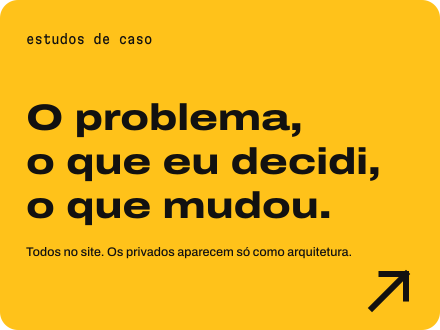

<a href="https://erickscur.com.br"></a>

<a href="https://erickscur.com.br"></a>

<p align="center"><b>Meu portfólio pessoal, no ar em <a href="https://erickscur.com.br">erickscur.com.br</a> e hospedado na HostGator.</b><br>HTML, CSS e JavaScript puros: sem framework, sem build, sem servidor de aplicação.</p>



## Os estudos de caso

Cada projeto do site tem uma ilustração animada e um estudo de caso: o problema, o que eu decidi, o que mudou. Clique para abrir.

<a href="https://erickscur.com.br/projetos/nerso.html"></a>
<a href="https://erickscur.com.br/projetos/reels-pipeline.html"></a>

<a href="https://erickscur.com.br/projetos/consultores.html"></a>
<a href="https://erickscur.com.br/projetos/candidatus.html"></a>

<a href="https://erickscur.com.br/projetos/maquina-1porcento.html"></a>
<a href="https://erickscur.com.br/#projetos"></a>

## Hospedagem



O site é estático e roda na **HostGator**, no domínio próprio [erickscur.com.br](https://erickscur.com.br). O `.htaccess` cuida de HTTPS, cache, cabeçalhos de segurança e da 404 desenhada. O passo a passo está em [Manual](#manual), em "Deploy na HostGator".

## Por dentro



- **Sem build.** Dois cliques no `index.html` e o site abre completo. O JS é clássico justamente para funcionar sem servidor.
- **Cada projeto tem uma ilustração animada**, feita em HTML, CSS e SVG. Não são prints: todo o conteúdo é de exemplo.
- **Motion com coreografia:** o nome sobe da linha de base, a galeria de projetos corre na horizontal, a carreira gira como um odômetro e o título do projeto vira o título do caso.
- **Sem JS, tudo aparece.** Com `prefers-reduced-motion`, nada se move e tudo aparece pronto.

## Manual

<details>
<summary><b>Estrutura de pastas</b></summary>

**Esta pasta é o site**: o `index.html` da raiz é a home.

```
index.html               home
projetos/*.html          um arquivo por estudo de caso
404.html                 página de erro (o .htaccess aponta para ela)
assets/css/site.css      a folha principal, em camadas (@layer)
assets/css/case.css      estilos dos estudos de caso
assets/css/covers.css    ilustrações animadas dos projetos (junta assets/css/covers/*.css)
assets/js/motion.js      o sistema de motion: tokens e coreografia
assets/js/main.js        entrada de JS (tema, cabeçalho, inicia o motion)
assets/js/covers.js      animações das ilustrações (junta assets/js/covers/*.js)
assets/vendor/           GSAP 3.15.0 (+ ScrollTrigger, SplitText, DrawSVG, Flip), Lenis 1.3.26
assets/fonts/            Archivo e Martian Mono, variáveis, com subset
assets/img/              foto recortada, sprite de logos e ícones, logos/ soltos, prévias (og/)
.htaccess  sitemap.xml  robots.txt  favicon.svg  ícones  site.webmanifest
Dockerfile  Caddyfile     servidor da Railway (o Caddyfile equivale ao .htaccess)

scripts/  revisao/  docs/  README.md   ← ferramentas suas. Não precisam subir; se subirem,
                                         o .htaccess bloqueia scripts/ e revisao/.
```

Os SVGs de `docs/readme/` são gerados pelo `scripts/gerar.py` do repositório do perfil (`ErickScur/ErickScur`), com `--portfolio docs/readme`.

</details>

<details>
<summary><b>Ver o site localmente</b></summary>

Dê dois cliques no `index.html`: o site abre completo no navegador, com fontes, animação e tema. O JS é clássico (sem `type="module"`) justamente para funcionar sem servidor.

Para simular o servidor de verdade (caminhos, 404), use:

```sh
python3 -m http.server 8000   # na raiz desta pasta; abra http://localhost:8000
```

</details>

<details>
<summary><b>Atualizar um dado</b></summary>

Todo número, cargo ou contato que muda com o tempo está marcado no HTML com um comentário logo antes do valor:

```html
<!-- DADO: seguidores-instagram -->106 mil pessoas no Instagram
```

Para atualizar: procure o nome (ex.: `DADO: seguidores-instagram`) em **todos** os arquivos `.html`, porque o mesmo dado pode aparecer em mais de um lugar, e troque o texto que vem depois do comentário. A tabela abaixo é gerada por `python3 scripts/listar-dados.py --readme`. Rode de novo depois de editar o HTML, porque as linhas mudam.

<!-- DADOS:inicio -->
| dado | arquivo | linha | valor atual |
|---|---|---|---|
| `cargo-atual` | `index.html` | 113 | Staff Engineer |
| `cargo-atual` | `index.html` | 136 | Staff |
| `cargo-atual` | `index.html` | 220 | Staff Engineer na Nestlé |
| `consultores-ferramentas-mcp` | `index.html` | 289 | 120 |
| `consultores-ferramentas-mcp` | `projetos/consultores.html` | 265 | 120 |
| `data-atualizacao` | `404.html` | 84 | 2026-10 |
| `data-atualizacao` | `index.html` | 908 | 2026-10 |
| `data-atualizacao` | `projetos/candidatus.html` | 312 | 2026-10 |
| `data-atualizacao` | `projetos/consultores.html` | 318 | 2026-10 |
| `data-atualizacao` | `projetos/maquina-1porcento.html` | 335 | 2026-10 |
| `data-atualizacao` | `projetos/nerso.html` | 359 | 2026-10 |
| `data-atualizacao` | `projetos/reels-pipeline.html` | 328 | 2026-10 |
| `email` | `index.html` | 888 | contato |
| `formatura` | `index.html` | 814 | julho de 2027 |
| `github-clean-node-api-commits` | `index.html` | 690 | 271 commits de Clean Architecture e TDD, 2022) e |
| `instagram` | `index.html` | 897 | @erickscur |
| `lancamento-dev-de-verdade` | `index.html` | 820 | 2025 |
| `leads` | `index.html` | 260 | 14 mil |
| `leads` | `index.html` | 839 | 14 mil leads |
| `leads` | `projetos/maquina-1porcento.html` | 264 | 14 |
| `linkedin` | `index.html` | 898 | LinkedIn |
| `nerso-custo-turno` | `projetos/nerso.html` | 308 | US$ 0,047 |
| `nerso-latencia` | `projetos/nerso.html` | 306 | 2,0 |
| `nerso-rotinas` | `projetos/nerso.html` | 310 | 7 |
| `nerso-voz-commits` | `projetos/nerso.html` | 312 | 301 |
| `nestle-modulos` | `index.html` | 225 | 13+ |
| `nestle-modulos` | `index.html` | 866 | 13+ |
| `promocao-staff` | `index.html` | 863 | jul 2026 |
| `seguidores-instagram` | `index.html` | 114 | 106 mil |
| `seguidores-instagram` | `index.html` | 134 | 106 mil |
| `seguidores-instagram` | `index.html` | 257 | 106 |
| `seguidores-instagram` | `projetos/maquina-1porcento.html` | 189 | 106 mil pessoas no |
| `seguidores-tiktok` | `index.html` | 259 | 18,6 mil |
| `tempo-mvp` | `index.html` | 287 | 2 |
| `tiktok` | `index.html` | 900 | @umporcentoprogramador |
| `vendas-dev-de-verdade` | `index.html` | 261 | R$ 40 mil+ |
| `vendas-dev-de-verdade` | `index.html` | 822 | Mais de R$ 40 mil em vendas, com a operação automatizada: ve |
| `vendas-dev-de-verdade` | `projetos/maquina-1porcento.html` | 268 | R$ 40 |
| `whatsapp` | `index.html` | 890 | (45) 99856-7207. O jeito mais rápido de falar comigo |
<!-- DADOS:fim -->

Fora dos marcadores:

- **Linha do tempo da carreira (home):** cada passo é um `<li class="tl-item">` dentro de `#carreira`, em ordem cronológica. Para um passo novo, copie o último `<li>` e troque `data-year` (o ano do odômetro), `data-lane` (a frente), o logo, a data e o texto. Passos marcantes levam `is-key` no `<li>` e `night` no cartão. Atualize também o "em 15 passos" do título.
- **Números do GitHub:** `python3 scripts/atualizar-github.py` mostra o que mudaria; `--gravar` grava. Usa o `gh` já logado na sua máquina. O navegador nunca chama a API.
- **Projeto novo:** copie um arquivo de `projetos/`, troque o conteúdo, o `view-transition-name` do `<h1>` (tem que ser igual ao do título na home), o link "próximo caso" e a imagem `og:image`. Acrescente a linha na lista de projetos da home e a URL no `sitemap.xml`.

</details>

<details>
<summary><b>Forçar atualização de CSS/JS</b></summary>

O `.htaccess` manda o navegador guardar CSS e JS por um ano. Quem garante a atualização é o `?v=` no fim do endereço:

```html
<link rel="stylesheet" href="assets/css/site.css?v=2026.10.28">
```

Mudou CSS ou JS? Troque a data do `?v=` pela data do dia em **todas** as páginas `.html` (busca e substitui). HTML não fica em cache, então a troca chega na hora. As bibliotecas em `vendor/` e as fontes têm a versão no nome do arquivo: uma versão nova é um arquivo novo.

</details>

<details>
<summary><b>Deploy na HostGator (cPanel)</b></summary>

O domínio `erickscur.com.br` aponta para a HostGator. Publicar aqui é manual: um `git push` não muda o site no ar.

1. Gere o zip só com o que é site. No Terminal, dentro desta pasta:
   ```sh
   zip -r site.zip index.html 404.html projetos assets .htaccess robots.txt sitemap.xml site.webmanifest favicon.svg favicon-32.png apple-touch-icon.png icon-192.png icon-512.png -x '*.DS_Store'
   ```
   Pelo Finder também funciona: selecione esses arquivos e pastas e use "Comprimir". O `.htaccess` é oculto: `Cmd+Shift+.` mostra.
2. No cPanel, abra o **Gerenciador de Arquivos** e entre em `public_html`.
3. Na primeira vez, apague o `index.html` padrão da HostGator, se existir.
4. **Carregar** → envie o `site.zip`.
5. Clique com o botão direito no zip → **Extrair** → destino `/public_html`. Confirme a substituição.
6. Apague o `site.zip` do servidor.
7. Em "Configurações" do Gerenciador, ative "Mostrar arquivos ocultos" e confira se o `.htaccess` está em `public_html`.
8. Em **SSL/TLS Status**, confira o certificado de `erickscur.com.br` e `www`. O `.htaccess` força HTTPS e manda o `www` para o domínio sem `www`.
9. Teste no celular, em 4G e fora do Wi-Fi:
   - `https://erickscur.com.br` abre, e `http://` e `www.` redirecionam;
   - um estudo de caso abre a partir da home;
   - `/qualquer-coisa` mostra a 404 desenhada;
   - o tema escuro do sistema é respeitado;
   - o link colado no WhatsApp mostra a prévia.

</details>

<details>
<summary><b>Deploy na Railway (alternativa)</b></summary>

A Railway lê o `Dockerfile`, que copia só os arquivos do site para uma imagem do Caddy; o `Caddyfile` faz o papel do `.htaccess` (404 desenhada, cache, cabeçalhos de segurança, `www` → sem `www`, bloqueio de `scripts/`, `revisao/` e arquivos ocultos). Com o serviço ligado ao repositório, todo push na `main` gera um deploy lá.

```sh
git add -A && git commit -m "o que mudou" && git push
```

Para testar o container antes:

```sh
docker build -t erickscur-site . && docker run --rm -e PORT=8080 -p 8080:8080 erickscur-site
# abra http://localhost:8080
```

Mudou de arquivo raiz (um ícone novo, por exemplo)? Acrescente na linha `COPY` do `Dockerfile`.

</details>

<details>
<summary><b>Sistema de design (v2)</b></summary>

Detalhes em `revisao/design-v2.md`.

- **Três frentes, três cores.** A cor é a categoria e sempre significa a mesma coisa: engenharia em vermelho (`--eng`), conteúdo em amarelo (`--cont`) e software house em azul (`--sh`). No HTML, `data-lane="eng|cont|sh|edu"` aplica os tokens da frente.
- **Tipo:** Archivo variável (largura 100–125%) para tudo, e Martian Mono para rótulos.
- **Seções alternadas:** papel, noite (`.night`) e blocos de cor.
- **Foto:** `assets/img/erick-scur-recorte.avif/.webp`, recortada do fundo (sem o logo da parede).
- **Ícones e logos:** `assets/img/sprite.svg`, embutido no fim de cada página. Ver o catálogo em `revisao/icones.html`. Uso: `<svg class="ico"><use href="#logo-nodedotjs"/></svg>`; os ícones de traço (`i-*`) levam `class="ico ico-stroke"`. Mexeu no sprite? Rode `python3 scripts/inline-sprite.py`.
- **Ilustrações dos projetos:** uma "tela" animada por projeto, em HTML/CSS/SVG (`assets/css/covers/<projeto>.css` e `assets/js/covers/<projeto>.js`, demos em `revisao/covers/`). São ilustrações, não prints: todo o conteúdo é de exemplo. Editou alguma? Rode `python3 scripts/juntar-covers.py`.

**Motion** (`assets/js/motion.js`):

1. **Hero:** o nome sobe da linha de base, as três camadas de cor e a foto entram (CSS puro, no primeiro paint) e reagem ao mouse. A faixa de logos acelera com o scroll.
2. **Três frentes:** os cartões de cor empilham; o de trás recua e escurece.
3. **Projetos:** a galeria fica pinada e corre na horizontal no desktop. Cada ilustração toca a sua animação quando entra.
4. **Carreira:** a linha vertical se desenha, o ano gigante rola como odômetro e cada passo acende na cor da sua frente.
5. **Transição:** o título do projeto vira o título do estudo de caso (View Transitions nativas).

Com `prefers-reduced-motion`, nada se move e tudo aparece pronto. Sem JS, tudo aparece.

</details>

<details>
<summary><b>Privacidade</b></summary>

- Nada interno da Nestlé além do nível do LinkedIn. A foto foi recortada para tirar o logo do fundo.
- Juntos360 e Candidatus aparecem com nome, link e identidade visual (autorizado). Sem print de tela real nem dado de cliente: as ilustrações são de exemplo.
- Repositório privado nunca tem link nem código: só arquitetura.
- O Pedro aparece só pelo primeiro nome, sem link.
- O vault do Nerso não é descrito, só a arquitetura.

</details>

<details>
<summary><b>Versão em inglês (depois)</b></summary>

A estrutura já está pronta para isso:

1. Copie `index.html` e `projetos/` para `en/`.
2. Traduza o texto. Os marcadores `DADO` são os mesmos nos dois idiomas, então a busca de um dado encontra as duas versões.
3. Troque `lang="pt-BR"` por `lang="en"`, ajuste os caminhos relativos (`../assets/`) e o `og:locale`.
4. Acrescente `<link rel="alternate" hreflang="...">` nas duas versões e as URLs no `sitemap.xml`.
5. Os poucos textos de interface do JS (rótulo do botão de tema) estão em `LABEL`, no topo de `main.js`.

</details>
